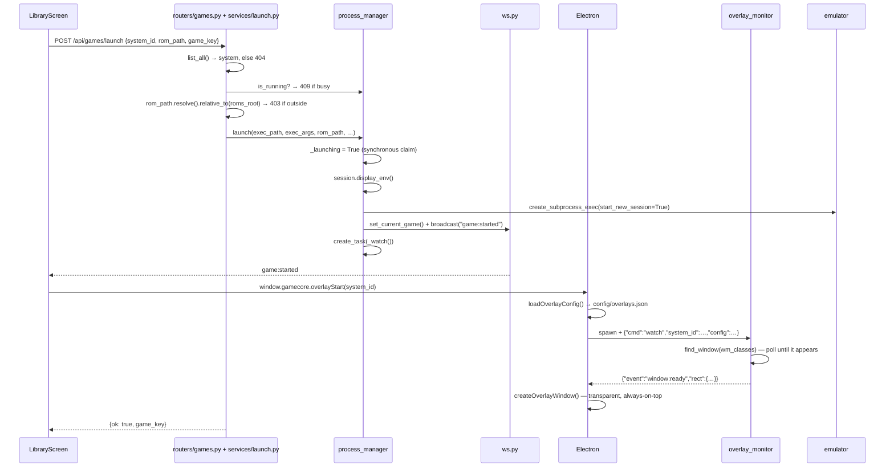
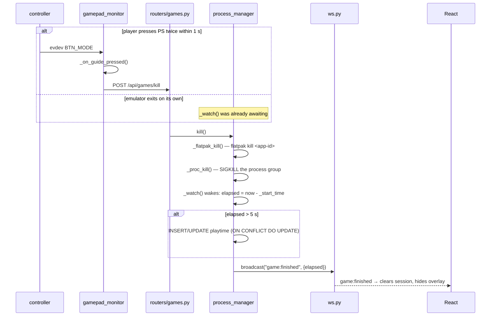
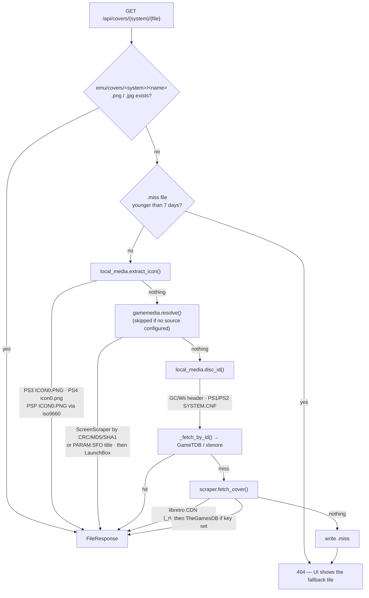
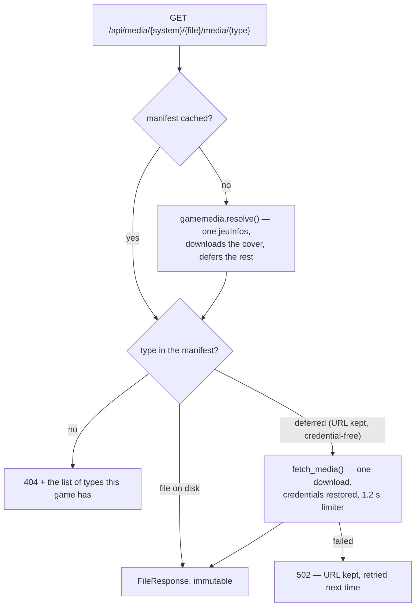
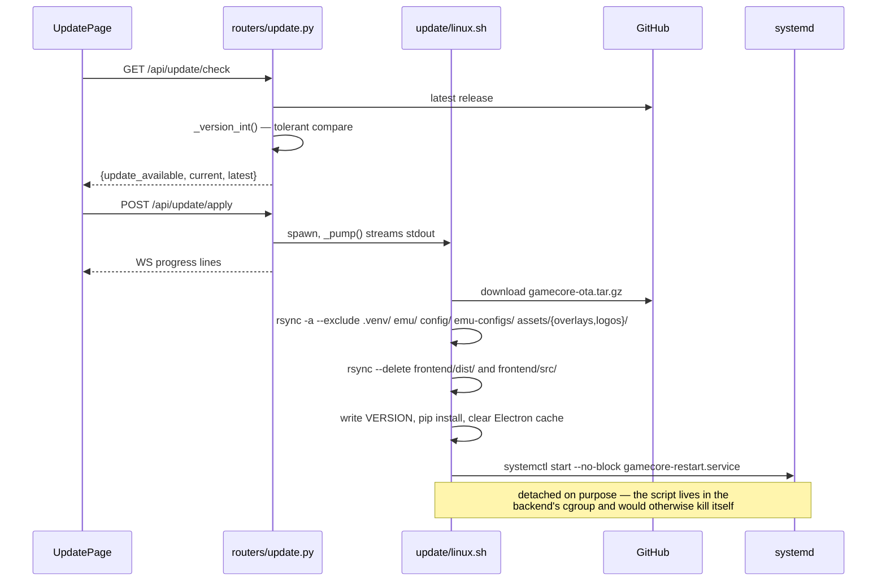
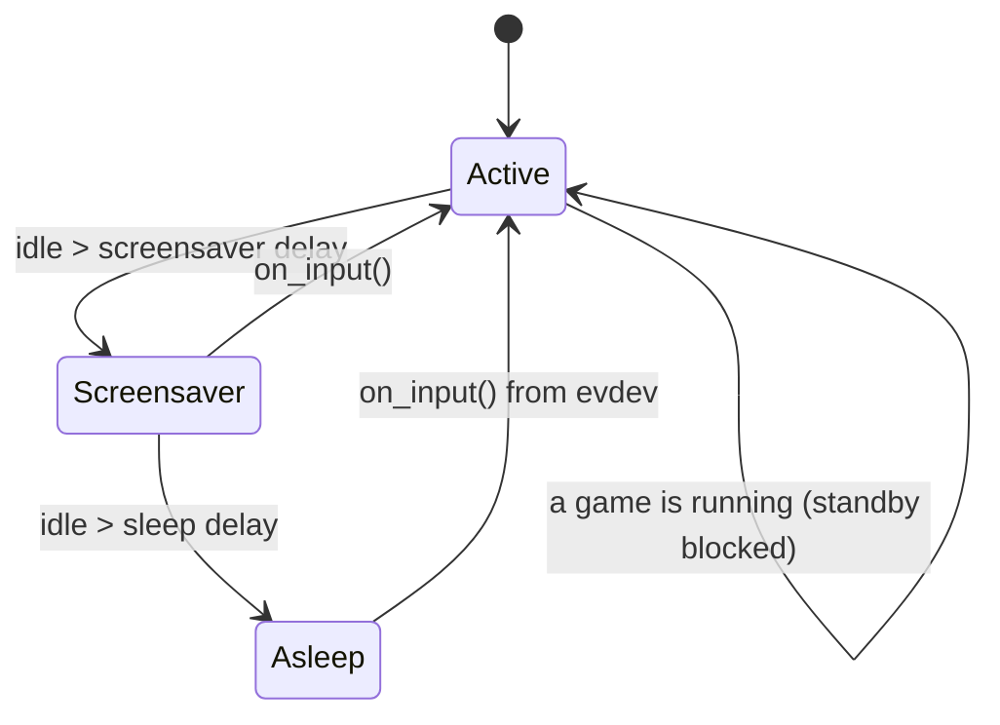
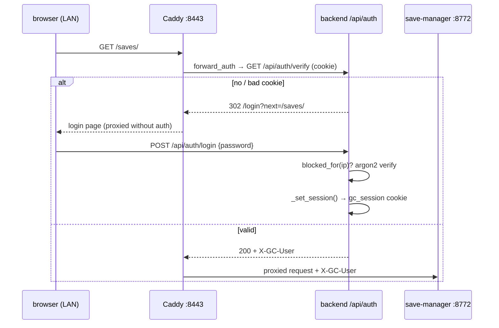
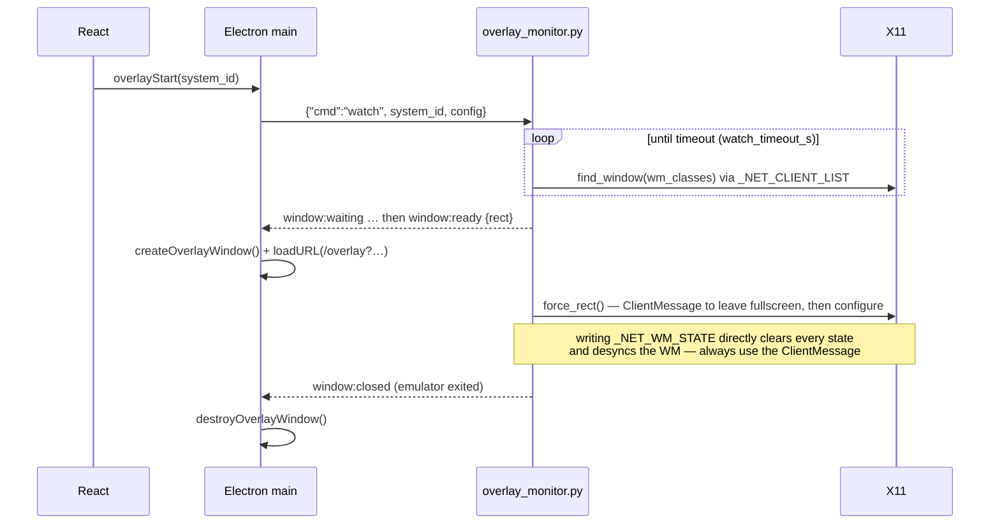

# 2 — Request flows

The paths worth knowing end to end. Every arrow names the function that runs.

## 1. Launching a game



After the response, `launch_game()` may also schedule two fire-and-forget
tasks, both driven by optional keys on the system entry:

- `"gamepadTrigger": true` → `_gamepad_trigger()` runs `sudo udevadm trigger`
  3× at 3 s intervals so Flatpak apps notice the pad.
- `"fullscreen": {…}` → `fullscreen_enforcer.enforce()`.

## 2. Ending a game

Two ways in, one way out.



Why it is built this way:

- **evdev, not the browser.** Chromium often hides the Guide button, and the
  UI is buried under a fullscreen emulator anyway.
- **Double press.** A single Guide press must never kill a game by accident
  (`GUIDE_DOUBLE_PRESS_MS`, mirrored in the frontend hook).
- **`flatpak kill` first.** SIGTERM to the `flatpak` wrapper never reaches the
  sandboxed app.
- **SIGKILL, never SIGTERM.** Several emulators answer SIGTERM with a
  confirmation dialog nobody can click from a gamepad.
- **The 5 s floor.** An emulator that dies instantly is not a play session.

## 3. Resolving a cover



Entry point: `services/cover_pipeline.py:resolve(system, filename, refresh)`.
`?refresh=1` skips the cache and the `.miss` check.

Tiers 2 and 4 are **offline and exact** — they read the game itself, so they
never mis-identify. Tier 3 is exact too when the ROM is a real file: a
CRC32 the ScreenScraper database recognises identifies the game outright, which
is the only exact method available on a cartridge (no embedded icon, no serial
to read). Tier 5 is fuzzy name matching and is only reached when the game
carries no identity anywhere.

Tier 3 is also the one that can be **absent**: with no ScreenScraper account
and no LaunchBox index, `gamemedia.available()` is False and the flow is the
one that ran before it existed.

## 3b. Resolving any other media



The manifest is scraped once per game and holds every media the sources have.
Only what is displayed is downloaded: a first request for `box-3d` costs one
HTTP call and **no ScreenScraper quota**, because the URL was already recorded.

## 4. OTA update



## 5. Standby, and waking up



`services/standby.py:run()` polls. `_enter(stage)` drives the transitions,
`_screen(False)` cuts the display over DPMS, `_governor("powersave")` drops the
CPU (optional, needs a sudoers rule). `on_input()` is called from
`gamepad_monitor`'s evdev loop — which is why a controller wakes the box even
though the UI is asleep and the browser is not listening.

Every stage change reaches the UI as a crossfade: `frontend/src/lib/standbyFade.ts`
writes the stage inside `document.startViewTransition` (500 ms, set in
`frontend/index.html`; skipped under reduced motion), so every theme's standby
fades in and out without knowing it. Going to sleep, `_enter("sleep")`
broadcasts, then waits for the TV window's `POST /api/standby/dark` (sent when the
fade to black ends) before DPMS, so the TV loses signal on a black frame. It
waits at most `_UI_DARK_WAIT_SECS` (3 s), not at all with no WebSocket client,
and does not cut the screen if a press woke the box meanwhile.

## 5b. Rest mode, and the wake

```mermaid
sequenceDiagram
    participant ui as PowerModal
    participant be as rest_mode.enter()
    participant pm as process_manager
    participant ld as logind
    ui->>ui: store.setAsleep(true): black over everything
    ui->>be: POST /api/power/rest (second press)
    be->>be: launch.close_gate(), wait for a launch in flight (15 s)
    be->>pm: kill() every session, frozen ones too
    be->>be: poll each process group; SIGKILL survivors after 8 s; 2 s more
    be->>ld: sudo -n systemctl suspend
    ld-->>be: PrepareForSleep(true): power:sleeping (any sleep path), sleep_guard sweep
    Note over ld: deep sleep; PS button wakes the box over Bluetooth
    ld-->>be: PrepareForSleep(false) (resume.py, gdbus monitor)
    be->>be: sweep again, open the gate, screen on
    be->>be: wait for a lit DRM connector (10 s max), display mode, settle delay
    be-->>ui: WS power:resumed (or GET /api/power/state after a reconnect)
    ui->>ui: store.wake(): black layer off, Home, splash from the start with its boot sound
```

- Nothing sleeps while a session is alive: every group is checked gone before
  `systemctl suspend`. A group still there after the forced kill is logged and
  the box sleeps anyway (a process in D state cannot be killed).
- **Every sleep closes the games**, not only Rest mode's: the backend holds a
  logind delay lock for `sleep` (`services/sleep_guard.py`, `systemd-inhibit
  --mode=delay … cat`, released by closing its stdin). On `PrepareForSleep(true)`
  it closes the launch gate, runs Rest mode's sweep with shorter waits (6 s,
  then SIGKILL, 2 s) and releases; logind holds the sleep up to
  `InhibitDelayMaxSec` (15 s with `/etc/systemd/logind.conf.d/90-gamecore.conf`,
  5 s without). On the wake it sweeps again (a sleep that outran the lock) and
  takes the lock back. The Rest mode button sweeps first, so the second sweep
  finds nothing and releases at once.
- The TV first: after a wake the HDMI link is back seconds before the
  picture. `power:sleeping` (and Rest mode's own second press) puts a plain
  black layer over everything; `resume.on_resume()` waits for a connector in
  `/sys/class/drm/card*-*` that is `connected`, `enabled` and `dpms` On
  (`services/display_ready.py`, 10 s at most, then it goes on anyway), then
  the player's `wake_settle_secs` (Settings → System, 0-8 s, 2.5 s default),
  and only then counts the wake and sends `power:resumed`. sysfs rather than
  xrandr: no X connection or privilege needed, and X is the slowest thing to
  come back. The sysfs state can still read "lit" from before the sleep for an
  instant, which the settle delay also covers.
- Power key: the same drop-in sets `HandlePowerKey=suspend`. In GameCore's own
  session nothing else takes the key (no PowerDevil), so a short press is a
  sleep with games closed; in a Plasma desktop session PowerDevil keeps its own
  setting. The long press is the firmware's force-off, untouched.
- Electron's `powerMonitor` `resume` (`electron/power.js`) puts the main
  window back in fullscreen and focus, tells the renderer to cover itself in
  black and forces a full repaint; everything else is the backend's.
- Wake permission: `gamecore-wake-setup` (root, boot + udev) arms the USB
  adapter and USB pads; `services/bt_wake.py` sets BlueZ `WakeAllowed=true` on
  paired pads and `false` on paired Bluetooth mice and keyboards (BlueZ allows
  HID wake by default; a moved mouse woke the box), at start, after each wake
  and whenever a new pad joins the roster. USB keyboards and the power button
  are not BlueZ's and keep waking it.
- What woke the box: `services/wake_source.py` keeps the wakeup counters
  from the sleep announcement and logs the ones that moved after the wake
  (`journalctl -u gamecore-backend | grep wake_source`). `3-3 (…)` is the
  Bluetooth adapter's USB port: a paired device paged the box.
- Pads off before any sleep: `sleep_guard.before_sleep()` runs
  `bt_wake.turn_off_pads()` next to the sweep, under the delay lock: BlueZ
  `Device1.Disconnect` on every connected paired pad (never audio, mice or
  keyboards), awaited, each call bounded by `BUSCTL_SECS`. That ends the link
  with HCI reason 0x13 "remote user terminated" (BlueZ → `MGMT_OP_DISCONNECT`
  → `hci_abort_conn(conn, HCI_ERROR_REMOTE_USER_TERM)`), which turns a pad
  off. Left to the kernel, the link ends at suspend with 0x15 "power off"
  (`hci_suspend_sync`), and an Xbox pad answers that by paging straight back,
  which woke the box at once. `WakeAllowed` stays set: the home button wakes it.

## 6. LAN authentication



The core's own `/api/*` is **403 from the LAN, always**. Addons contain no
auth code — Caddy is the enforcement point. The TV bypasses all of this over
loopback.

## 7. Overlay lifecycle



The whole feature is disabled when `WAYLAND_DISPLAY` is set
(`_WAYLAND_SESSION`), silently. A dev machine on Wayland will never reproduce
an overlay bug.
